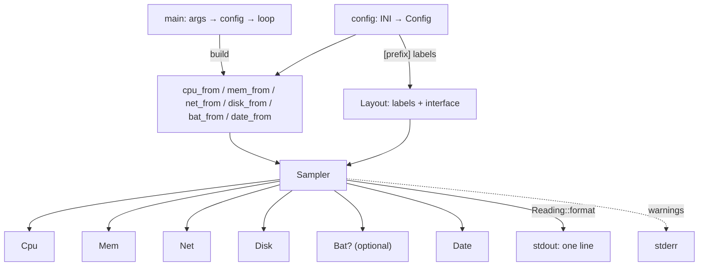
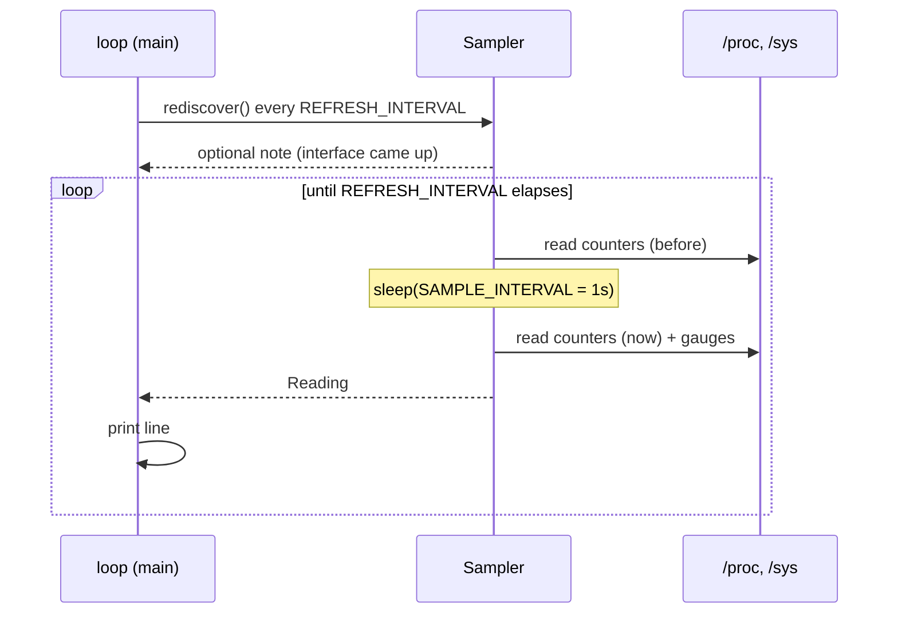

# Architecture

`status` is a single binary with no runtime threads. One loop reads pseudo-files,
formats a line and writes it; everything else is a pure function over text.

## Module layout

| Module | Responsibility | Tests |
| --- | --- | --- |
| [`main`](../src/main.rs) | Argument parsing, config discovery, print loop, exit codes | — |
| [`config`](../src/config.rs) | INI subset parser, lookup order, typed getters with defaults | 6 |
| [`metrics`](../src/metrics.rs) | `Sampler`: timing, counter pairing, failure fallback, line format | 6 |
| [`cpu`](../src/cpu.rs) | `/proc/stat` ticks, `/proc/cpuinfo` MHz and core count, thermal zone selection | 8 |
| [`mem`](../src/mem.rs) | `/proc/meminfo` fields, used/available/total selection | 4 |
| [`net`](../src/net.rs) | Interface discovery, byte counters, throughput formatting | 10 |
| [`disk`](../src/disk.rs) | `/proc/diskstats` sectors, `statvfs` space, device auto-detection | 9 |
| [`bat`](../src/bat.rs) | `power_supply` state, capacity, power, time estimate | 6 |
| [`date`](../src/date.rs) | Clock format validation and rendering | 4 |
| [`units`](../src/units.rs) | The one place that defines KiB/MiB/GiB, byte→KiB conversion and per-metric display format (`Amount`: divisor + suffix + auto-scaling) | 13 |
| [`prefix`](../src/prefix.rs) | The `[prefix]` labels printed before each field, with their defaults | 4 |
| [`sysfs`](../src/sysfs.rs) | `read_trimmed`/`read_u64`/`read_f64`, saturating deltas | 2 |
| [`fixtures`](../src/fixtures.rs) | Captured kernel output as regression fixtures (tests only) | 12 |

The split is by *data source*, not by output field: each module owns the files it
reads, exposes a parsed `Sample` struct, and knows how to render it. Nothing
knows the whole line except [`metrics::Reading::format`](../src/metrics.rs:68).
The one value that is not a reading — the `[prefix]` labels — has its own small
module, [`prefix`](../src/prefix.rs), so adding a field means adding a label
there, never hunting for format strings.



## Sampling model



Two constants set the rhythm ([`metrics.rs:35`](../src/metrics.rs:35)):

- `SAMPLE_INTERVAL = 1s` — the gap between the two counter snapshots. Because it
  is a constant, `Δbytes` is already bytes-per-second and no wall-clock
  bookkeeping is needed.
- `REFRESH_INTERVAL = 10s` — how often a failed interface detection is retried
  (see [`Sampler::rediscover`](../src/metrics.rs:151)). It also bounds the outer
  loop, so the two nested loops keep the line cadence aligned to a 10 s grid
  instead of drifting. Everything else, `statvfs` included, is re-read on every
  line; only the interface *discovery* is expensive enough to defer.

`rediscover` deliberately only retries **while the interface is unknown**. Once
an interface works, switching to a different one would mix two devices'
counters, producing a bogus one-line spike.

## Formatting contract

`Reading` holds one `Result`/`Option` per field, and
[`format`](../src/metrics.rs:68) joins the enabled ones with ` | ` inside
brackets:

- optional fields (`cpu_temp`, `battery`, `net`, `disk_io`) are `Option` —
  `None` removes the field entirely rather than printing an empty slot;
- a metric disabled in the config is `None` *and* unread: `Sampler::sample`
  never calls the reader, so no `openat` happens. This is why the toggles are
  stored on the sampler (`Cpu::freq_enabled`, `Disk::io_enabled`,
  `Option<Net>`) instead of being checked inside `format` — display-only
  suppression would still pay for the syscall and could still emit a warning;
- required fields are `Result` — `Err` prints a short `n/a …` token that names
  what is missing;
- numbers carry the suffix of the unit actually used: `Amount` owns divisor,
  suffix and auto-scaling together, so the label can never disagree with the
  arithmetic. A suffix the code does not recognise (`packets`) is printed
  verbatim and never rewritten.

That split is what lets a desktop without a battery and a laptop with one run
the same binary and still produce a single well-formed line.

## Error policy

The invariant: **no input can abort the line.**

| Layer | Failure handling |
| --- | --- |
| File read | `Result` with the path in the message, never `unwrap` |
| Parse | `Option`, `None` means "field absent" not `0` |
| Counter reset / no progress | delta is unknown → `0`, never the raw total |
| Metric unavailable | `n/a` token, or the field is omitted |
| Config value invalid | default + a warning on stderr |
| `[date] fmt` unrenderable | validated at startup, default + warning |
| stdout closed | exit `0` instead of panicking on `EPIPE` |

Config *presence* is the one hard failure: `--config` naming an unreadable file
exits `1`, because the user explicitly asked for it. A missing file from the
*search* only warns, so a fresh install runs with defaults.

## Testing

Tests live in each module's `#[cfg(test)] mod tests` and assert behaviour, not
wiring: a delta rather than a total, saturating subtraction on a counter reset,
a short `meminfo`, a temperature that is absent rather than zero, a format that
must not panic. Fixtures are built in `std::env::temp_dir()` and passed in
through `with_root`/`with_paths`-style test-only constructors, so the parsers are
exercised without touching the real machine.

```sh
cargo test            # 80 tests
cargo clippy --all-targets
```

### Two kinds of fixture

Synthetic fixtures encode *what we believe* the kernel prints; real fixtures
record *what it actually printed*. Both are needed:

- [`src/*.rs`](../src) `#[cfg(test)]` blocks build minimal inputs (a two-line
  `meminfo`, a counter reset) to pin one behaviour each.
- [`fixtures/`](../fixtures) holds files copied from a live machine, reduced to
  the keys the parsers read: a `meminfo` excerpt ending at `MemAvailable`, a
  real `cpu` line with all eleven columns, a real `nvme0n1` `diskstats` row, an
  `acpitz` zone, and a whole `BAT0` directory. `fixtures::tests` drives the
  parsers with them.

The real fixtures catch the failure mode the synthetic ones cannot: a parser
that is *self-consistently wrong*. `MemTotal` and `MemFree` parse fine in
isolation, but only a real file shows that `MemAvailable` sits between them and
that picking the wrong one silently changes every memory reading. They are
checked into the repository and read via `CARGO_MANIFEST_DIR`, so a deleted
fixture fails its test instead of skipping it.

## Deliberate omissions

- **No threads/timers**: the 1 s cadence comes from `sleep` inside `sample`, so
  ordering between "read counters" and "print" is trivial to reason about.
- **No `procfs` crate**: the three files used have stable, documented formats and
  a parser is a dozen lines; the dependency cost (and its `chrono`/`libc` pin
  churn) exceeded the benefit. `nix` is used only for `statvfs`, where the
  struct layout must match libc exactly.
- **No caching layer**: process start to first line is one second, which is the
  sampling interval itself; there is nothing to warm up.
