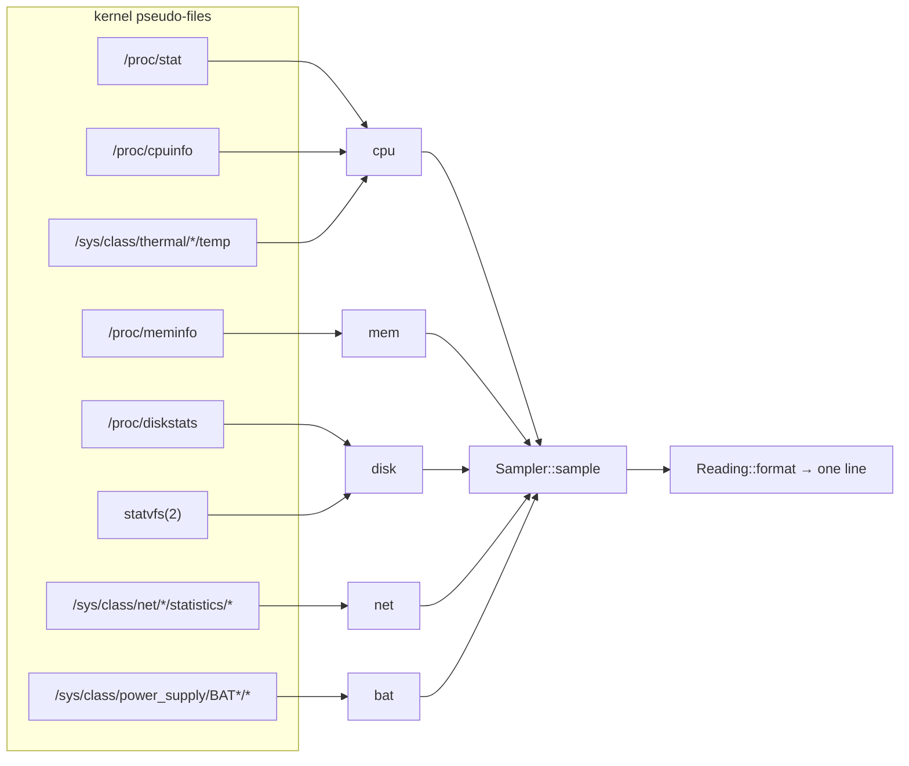

# How the numbers are computed

Every metric comes from a kernel pseudo-file. This page lists the source, the
arithmetic and the failure mode, so a number that looks wrong can be traced back
to a file. Module links point at the implementing code.

A disabled metric (`[cpu] temp = no` for temperature, `[cpu] mhz = no`,
`[net] show = no`, `[disk_io] show = no`, `[bat] show = no`) is not computed and
not displayed: the file behind it is never opened, and the field disappears
instead of printing a zero. `strace -e trace=openat` shows the difference
directly.

One sample line, with every field enabled:

```
[cpu: 12% 2400MHz 45°C | mem: 8192MiB | bat: 50- 12.0W 2:30 | net: 3K/s↓ 1K/s↑ | disk: 1.0GiB | io: 2M/s↑ 1M/s↓ | date: 2024-01-02 03:04:05]
```

Usage, frequency and temperature share one `|` group — three readings of one
device. Every other field is its own group. Throughput is `K/s` by default and
capacity `GiB`; both are configurable, see
[config.md](config.md#suffix-and-unit-rules).



## Two kinds of metric

**Counters** only ever increase (CPU ticks, network bytes, disk sectors). A
value on its own says nothing — only the *difference* between two readings
divided by the elapsed time is meaningful. These are sampled twice, one second
apart, by [`Sampler::sample`](../src/metrics.rs:178).

**Gauges** are point-in-time values (temperature, memory, clock) and need one
read.

Because the interval is a compile-time constant
(`SAMPLE_INTERVAL = 1s`), a delta in bytes is directly a per-second rate — no
wall-clock bookkeeping, and no drift between runs.

```
before ──read──┐                    ┌──read── after
               │  sleep(1s)         │
               └────────────────────┘
rate = (after - before) / 1s
```

## CPU busy — `/proc/stat`

The aggregate `cpu` line holds cumulative jiffies in fixed columns:

| Column | Field |
| --- | --- |
| 1 | `user` |
| 2 | `nice` |
| 3 | `system` |
| 4 | `idle` |
| 5 | `iowait` |
| 6 | `irq` |
| 7 | `softirq` |
| 8 | `steal` |

```
total = Σ columns 1..8          idle = idle + iowait
busy% = (Δtotal - Δidle) / Δtotal × 100
```

That formula describes the whole machine, which is why the default output
cannot exceed `100%`: sixteen cores each 100 % busy would still read `100%`,
because the aggregate line merges them before the ratio is taken. To get the
`htop` scale, `[cpu] per_core = yes` multiplies by the logical core count
(`/proc/cpuinfo` `processor` entries), so the same machine can read `1600%`.
Which scale is in use is a config decision, never a silent one.

Three details worth knowing:

- `iowait` counts as **idle**: a core blocked on disk is not doing work, and
  counting it as busy is what makes naive monitors jump to 100 % during a copy.
- Deltas, not totals. Using the totals (a bug in the original code) makes the
  number converge to the machine's lifetime average and stop reacting.
- If the counters did not advance (`Δtotal == 0`, possible when the kernel
  coalesces ticks or after a suspend), there is no percentage → the line shows
  `0%` rather than dividing by zero.
- `Δidle` is clamped to `Δtotal` so a counter reset cannot produce a negative
  busy value.
- Per-core scaling is opt-in. With the switch off the core count is never read,
  so the default keeps the single-file cost it always had; if the count cannot
  be read, the machine figure is printed rather than nothing.

## CPU frequency — `/proc/cpuinfo`

Every core block has a `cpu MHz : 1478.000` line; the value is the mean over
all cores. Kernels that omit the field (many ARM boards) make the field
unreadable, which shows as `n/a MHz` — the rest of the line is unaffected.

## CPU temperature — `/sys/class/thermal/thermal_zoneN/temp`

The file holds millidegrees Celsius as an integer (`45000` → `45°C`). See
[config.md](config.md#cpu) for the zone selection order. A zone whose `type`
is `acpitz` is a chipset sensor that reacts slowly and reads low under load; it
is used only when no package/core sensor exists.

## Memory — `/proc/meminfo`

```
used      = MemTotal - MemAvailable
available = MemAvailable
total     = MemTotal
```

All values are in KiB in the file and divided by the configured factor for
display — MiB by default, so a 24 GiB machine reads `7.9GiB` when it is 70 %
full and `16.0GiB`/`23.9GiB` for total.

`MemAvailable` is the kernel's own estimate of how much can be allocated
without swapping (added in Linux 3.14). Using `MemFree` instead is the classic
mistake: it excludes page cache, so a machine that is merely holding files in
RAM looks nearly full. If `MemAvailable` is missing, the metric reports an
error rather than fabricating `total - 0`.

## Network throughput — `/sys/class/net/<nic>/statistics/`

`rx_bytes` and `tx_bytes` are cumulative byte counters. Per line:

```
rx rate = (rx_now - rx_before) / 1024 → KiB, then divided by the configured factor
tx rate = (tx_now - tx_before) / 1024
```

Rendered receive-first: `55K/s↓ 3K/s↑`. The unit is `unit` + `/s`, unless
`suffix` already contains `/s` (see [config.md](config.md#suffix-and-unit-rules)).

Interface choice is described in [config.md](config.md#net). Only the chosen
interface is read, so the numbers are that link's traffic, not the sum of all
interfaces.

## Disk I/O — `/proc/diskstats`

```
rate = sectors × 512 bytes / 1024 = KiB, then divided by the configured factor
```

The relevant columns are sector counts, not byte counts:

| Column | Field |
| --- | --- |
| 6 | sectors read |
| 10 | sectors written |

`sectors` are always 512-byte units in this file regardless of the device's
physical sector size, so the conversion is a fixed `× 512`. Rendered
write-first: `2M/s↑ 1M/s↓`, matching "is the disk busy writing?".

If the configured device is absent the field shows `n/a io` and stderr names
the device. A silent `0` would be indistinguishable from an idle disk.

## Filesystem space — `statvfs(2)`

```
total     = f_blocks × f_frsize
available = f_bavail × f_frsize
used      = (f_blocks - f_bfree) × f_frsize
```

- `f_bavail` (not `f_bfree`) is what a non-root user can write, so it excludes
  the reserved blocks — on ext4 typically 5 % of the volume. That is why
  "available" can look smaller than "total − used".
- `f_frsize` is the fragment size, which equals the block size on Linux
  filesystems; using `f_bsize` is the common shortcut but is not always the
  allocation unit.
- Display keeps one decimal (`127.5GiB`) so that a small change is visible at
  large sizes; rates are whole numbers. The default unit is GiB: a volume is
  quoted in gigabytes, and the old MiB figure (`130512.5MiB`) was read as MB by
  everyone who saw it.

## Battery — `/sys/class/power_supply/BAT*`

| Field | Source | Notes |
| --- | --- | --- |
| State | `status` | `Charging` → `+`, `Discharging` → `-`, `Not charging`/`Full` → `#`, unknown → `?` |
| Percent | `capacity` | Mandatory; without it the whole field is `n/a bat` |
| Remaining time | `charge_now / charge_full` and `current_now` | Only while discharging: `charge_now / current_now` hours, printed `H:MM` |
| Power | `power_now`, else `voltage_now × current_now` | `µV × µA = pW`, so `/1e12` gives watts |

**Power is a battery quantity only while charge moves.** On mains (`Full`,
`Not charging`) the driver may still report a current — a full pack here
reported `1020000` µA at `17029000` µV — but that product is what the machine
draws from the adapter, not what the battery receives. Multiplied and printed,
it claimed `17.4W` while the battery was not charging at all. So the state is
checked first, and the rate is read only for `Charging`/`Discharging`.

The remaining time follows the same rule: a plugged-in battery reports
`status = Not charging` (or `Full`) and `current_now = 0`, and dividing by zero
would be "0:00 forever" dressed up as data. Those states print no time.

A battery at `100` that is not discharging collapses to just `100` — no
symbol (there is no direction), no power, no estimate. `100` while
**discharging** is not that case: the pack is on its way down and keeps its
symbol, rate and estimate.

## Clock

`chrono`'s `strftime` over the configured `[date] fmt`, default
`%Y-%m-%d %H:%M:%S`. An empty value means the default.

The pattern is validated once at startup with chrono's `StrftimeItems`: an
unknown specifier (`%Q`) or a dangling `%` makes chrono panic from `Display`,
so such a value is rejected with a warning on stderr and the default format is
used instead. A literal percent still works as `%%`. `Date::new` is the only
place that accepts user input for the clock, which keeps `render` panic-free.

## Why the rates can read zero

Rates are integers after the KiB conversion. Idle traffic (a few hundred bytes
per second) therefore rounds down to `0 K/s`, which is honest for a
one-second window — a longer window would be needed to see it. Raise the unit
(`[disk_io] unit = 1` shows MiB) if you want coarse numbers, or read the counters
directly for byte precision.
